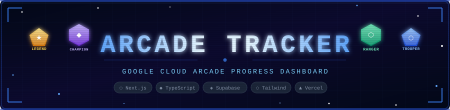

<p align="center">
  

<p align="center">
  
  
  
  
  
  
  
   </p>
</p>

---

# 🎮 ArcadeTracker
A full-stack web dashboard for **Google Cloud Arcade Festival (GCAF)** players featuring real-time point tracking, a tier system, and a comprehensive catalog of skill badges

Paste your public Skills Boost profile URL and immediately see:
- **Arcade Points** game badges (+1) and skill badges (+0.5) for the active period
- **Tier Eligibility** Trooper (50+) → Ranger (75+) → Champion (95+) → Legend (120+)
- **Facilitator Milestones** M1 (+5 pts), M2 (+15 pts), Ultimate (+25 pts) progress bars
- **Active July 2026 Tracks** the six monthly game tracks with completion status
- **FastTrack Catalog** 50+ skill badges searchable by name, difficulty, and category
- **Live Leaderboard** real-time with a podium and full rankings

## ✨ Key Features

### 🧑‍💻 Player Dashboard
- **Automatic Point Summary** Automatic calculation: Game Badge (×1 pt) + Skill Badge (×0.5 pt) + Facilitator Milestone Bonus
- **Tier System** Legend (120+), Champion (95+), Ranger (75+), Trooper (50+) with a progress bar to the next tier
- **Milestone Tracker** M1 / M2 / M3 / Ultimate Milestone with extra bonus points
- **Active Game Tracks** 6 Arcade tracks complete with access codes
- **Fast Track Catalog** 50+ GCAF 2026 skill badges that can be filtered by category, difficulty level, and completion status
- **Badge History** “My Badges” tab displaying all earned badges, with current/archive filters and an activity heatmap
- **Activity Chart**  Visual breakdown of badge earnings over time
- **Activity Heatmap** 26 week GitHub-style calendar heatmap of badge earning days
- **Streak Counter** Current and all-time longest consecutive activity streak
- **Leaderboard** Track your rank and compete with other players based on total points, badges earned, and milestone progress.

### 👩‍🏫 Facilitator Panel
- **Member Management** View and manage all participants associated with a facilitator code
- **CSV Import** Bulk-upload participant data via CSV with validation, per-row status feedback, and rollback support
- **Email Sending** Send targeted emails to selected participants directly from the dashboard
- **Batch History** Full log of every CSV import with rollback option for any batch
- **Real-Time Sync** Member list updates instantly via **Supabase Realtime** subscriptions

### 🛠️ Admin Panel
- **Global Statistics** Live counts: total participants, total badges, game badges, skill badges, active facilitators
- **Participant Overview** Lists of recently synced and unsynced participants with direct profile links
- **Facilitator Code Management** Add and delete facilitator codes with name labels
- **Master Sync** Trigger a bulk synchronization of all participant data to the Arcade sheet
- **Maintenance Mode** Toggle site-wide maintenance mode on/off with a single click
- **Audit Log** Paginated, timestamped log of all admin actions with actor, target, and metadata
- **Feedback Management** View and manage player feedback submissions with ratings and categories

## 🎯 Point System & Levels

### Point Calculation

```
Total Points = Game Badges × 1 pt
           + Skill Badges × 0.5 pt
           + Facilitator Bonus (from achievement milestones)
```

### Milestones & Bonuses

| Milestone | Game Badges | Skill Badges | Point Bonus |
|---|---|---|---|
| Milestone 1 | 6 | 14 | +7 points |
| Milestone 2 | 8 | 28 | +18 points |
| Achievement Milestone 3 | 10 | 42 | +29 points |
| Highest Achievement Milestone | 12 | 56 | +40 points |

### Levels

| Tier | Min. Points | Level |
|---|---|---|
| Legend | 120+ |1|
| Champion | 95+ |2|
| Ranger | 75+ |3|
| Trooper | 50+ |4|


## 🚀 How to Run

### Prerequisites
- Node.js 18+
- pnpm / npm / yarn

### Installation Steps

```bash
# 1. Clone the repository
git clone https://github.com/RakkaEvandra06/ArcadeTracker.git

# 2. Navigate to the project folder
cd ArcadeTracker

# 3. Install dependencies
npm install

# 4. Run the development server
npm run dev
```

## 📂 Project Structure
 
```
ArcadeTracker/
├── public
│   ├── 500px.png
│   ├── OpenGraph.png
│   └── banner.svg
├── src
│   ├── __tests__
│   │   ├── api.test.ts
│   │   ├── milestones.test.ts
│   │   ├── security.test.ts
│   │   └── session.test.ts
│   ├── app
│   │   ├── admin
│   │   │   └── page.tsx
│   │   ├── admin-login
│   │   │   └── page.tsx
│   │   ├── api
│   │   │   ├── admin
│   │   │   │   ├── audit-logs
│   │   │   │   │   └── route.ts
│   │   │   │   ├── facilitators
│   │   │   │   │   └── route.ts
│   │   │   │   ├── maintenance
│   │   │   │   │   └── route.ts
│   │   │   │   ├── master-sync
│   │   │   │   │   └── route.ts
│   │   │   │   └── stats
│   │   │   │       └── route.ts
│   │   │   ├── auth
│   │   │   │   ├── login
│   │   │   │   │   └── route.ts
│   │   │   │   ├── logout
│   │   │   │   │   └── route.ts
│   │   │   │   └── me
│   │   │   │       └── route.ts
│   │   │   ├── cron
│   │   │   │   ├── refresh-leaderboard
│   │   │   │   │   └── route.ts
│   │   │   │   └── sync-participants
│   │   │   │       └── route.ts
│   │   │   ├── facilitator
│   │   │   │   ├── batches
│   │   │   │   │   └── route.ts
│   │   │   │   ├── email
│   │   │   │   │   └── route.ts
│   │   │   │   ├── import
│   │   │   │   │   └── route.ts
│   │   │   │   └── members
│   │   │   │       └── route.ts
│   │   │   ├── feedback
│   │   │   │   └── route.ts
│   │   │   ├── participants
│   │   │   │   ├── [id]
│   │   │   │   │   └── route.ts
│   │   │   │   └── route.ts
│   │   │   ├── scrape
│   │   │   │   └── route.ts
│   │   │   └── skills
│   │   │       └── route.ts
│   │   ├── dashboard
│   │   │   └── page.tsx
│   │   ├── facilitator
│   │   │   └── page.tsx
│   │   ├── facilitator-login
│   │   │   └── page.tsx
│   │   ├── player-login
│   │   │   └── page.tsx
│   │   ├── globals.css
│   │   ├── icon.png
│   │   ├── layout.tsx
│   │   └── page.tsx
│   ├── components
│   │   ├── AccessCodeModal.tsx
│   │   ├── ActivityChart.tsx
│   │   ├── ActivityHeatmap.tsx
│   │   ├── AdminPanel.tsx
│   │   ├── Dashboard.tsx
│   │   ├── DashboardSkeleton.tsx
│   │   ├── FacilitatorPanel.tsx
│   │   ├── Header.tsx
│   │   ├── Icons.tsx
│   │   ├── Leaderboard.tsx
│   │   ├── PlayerDashboardClient.tsx
│   │   ├── PlayerShell.tsx
│   │   ├── ProfileHeader.tsx
│   │   ├── Providers.tsx
│   │   ├── SignOutDialog.tsx
│   │   ├── ThemeLangToggle.tsx
│   │   ├── ThemeToggle.tsx
│   │   └── Toast.tsx
│   ├── lib
│   │   ├── LanguageContext.tsx
│   │   ├── ThemeContext.tsx
│   │   ├── csp.ts
│   │   ├── db.ts
│   │   ├── i18n.ts
│   │   ├── localAuth.ts
│   │   ├── milestones.ts
│   │   ├── scoring.ts
│   │   ├── scrapeProfile.ts
│   │   ├── security.ts
│   │   ├── session-constants.ts
│   │   ├── session.ts
│   │   ├── streak.ts
│   │   ├── supabase-client.ts
│   │   └── useTheme.ts
│   ├── instrumentation.ts
│   └── middleware.ts
├── .gitignore
├── LICENSE.txt
├── README.md
├── eslint.config.mjs
├── jest.config.ts
├── next.config.ts
├── package-lock.json
├── package.json
├── postcss.config.mjs
├── tsconfig.json
└── vercel.json
```

## 🤝 Contributing
 
Contributions are welcome and appreciated! Here's how to get involved:
 
### Reporting Bugs
 
1. Search the [Issues](https://github.com/RakkaEvandra06/ArcadeTracker/issues) page to check if it's already reported
2. Open a new issue with the **Bug Report** template
3. Include: your OS, Node.js version, steps to reproduce, expected vs actual behavior, and any error messages
### Suggesting Features
 
1. Open a new issue with the **Feature Request** template
2. Describe the problem your idea solves and your proposed solution
3. Discuss the approach in the issue before opening a pull request

### Submitting a Pull Request
 
```bash
# 1. Fork the repository on GitHub
 
# 2. Clone your fork
git clone https://github.com/RakkaEvandra06/ArcadeTracker.git
cd ArcadeTracker
 
# 3. Create a feature branch
git checkout -b feature/your-feature-name
 
# 4. Install dependencies
npm install
 
# 5. Make your changes — keep commits focused and descriptive
 
# 6. Lint your code before committing
npm run lint
 
# 7. Push your branch
git push origin feature/your-feature-name
 
# 8. Open a Pull Request on GitHub against the main branch
```

### Contribution Guidelines
 
- Follow the existing TypeScript and Tailwind code style
- Keep pull requests focused one feature or bug fix per PR
- Add or update comments for any non-obvious logic
- Do not commit `.env.local` or any secrets
- Test your changes locally with `npm run dev` and `npm run build` before submitting

## 📬 Contact

Have a question, found a bug, or want to collaborate?
| Channel | Link |
|---|---|
| **GitHub** | [@RakkaEvandra06](https://github.com/RakkaEvandra06) |
| **Issues** | [ArcadeTracker Issues](https://github.com/RakkaEvandra06/ArcadeTracker/issues) |

Feel free to open a GitHub issue for any bug reports, feature requests, or general questions about the project.

## 📄 License
 
This project is licensed under the **MIT License**.
See [LICENSE.txt](LICENSE.txt) for the full license text.

<p align="center"> Made with ❤️ by <a href="https://github.com/RakkaEvandra06">RakkaEvandra06</a>, Google Cloud Arcade Facilitator 2026 </p>